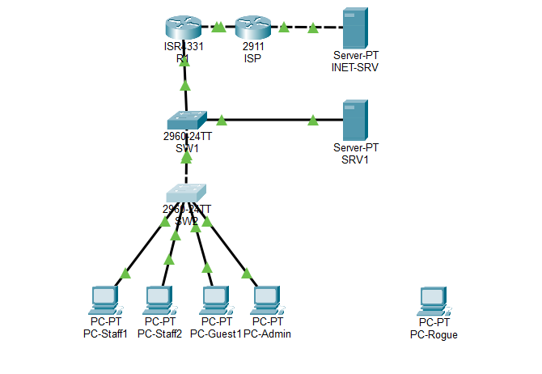
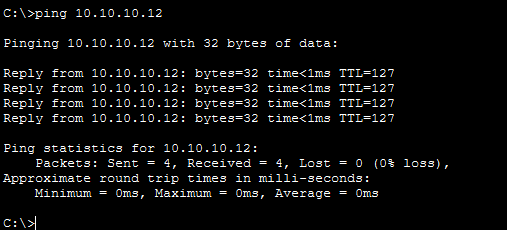
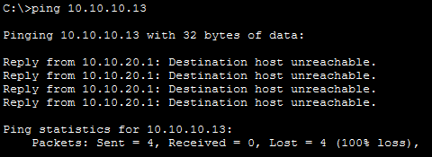

# Secure Multi-VLAN Office Network

A small-office network built and verified in Cisco Packet Tracer: VLAN segmentation, router-on-a-stick inter-VLAN routing, DHCP/DNS/PAT, inter-VLAN ACLs, SSH-only management and Layer 2 hardening, with before/after evidence.

> **This is a lab simulation.** Everything runs in Cisco Packet Tracer. No physical equipment was used. See [What I would do in production](#what-i-would-do-in-production).

## Scenario

A small office has four segments (Staff, Guest, Server, Management) behind one edge router connected to a simulated ISP. Requirements:

- Staff may reach the Internet and only DNS and HTTP on the internal server.
- Guest may reach the Internet only (Staff, Server and Management are blocked).
- Only the Management VLAN may use SSH to manage network devices.

## Topology



| Device | Model | Role |
|---|---|---|
| R1 | ISR 4331 | Edge router, router-on-a-stick, DHCP, NAT, ACLs |
| ISP | ISR 4331 / 2911 | Simulated ISP |
| SW1 | Catalyst 2960 | Distribution switch |
| SW2 | Catalyst 2960 | Access switch |
| SRV1 | Server-PT | Internal DNS and HTTP (VLAN 30) |
| INET-SRV | Server-PT | Simulated Internet web and DNS |
| PC-Staff1, PC-Staff2, PC-Guest1, PC-Admin | PC-PT | End devices |

<!-- Edit the ISP model above to match what you actually used. -->

## Tools and versions

- Cisco Packet Tracer **9.0.1.0858**
- Git / GitHub

## IP plan

| VLAN | Name | Subnet | Gateway | DHCP range | Notes |
|---|---|---|---|---|---|
| 10 | STAFF | 10.10.10.0/24 | 10.10.10.1 | .11-.254 | DNS 10.10.30.10 |
| 20 | GUEST | 10.10.20.0/24 | 10.10.20.1 | .11-.254 | DNS 198.51.100.10 |
| 30 | SERVER | 10.10.30.0/24 | 10.10.30.1 | static | SRV1 10.10.30.10 |
| 99 | MGMT | 10.10.99.0/24 | 10.10.99.1 | static | SW1 .2, SW2 .3, PC-Admin .11 |
| 999 | NATIVE | none | none | none | unused, parked ports |
| n/a | ISP link | 203.0.113.0/30 | R1 .1, ISP .2 | n/a | PAT on R1 g0/0/1 |
| n/a | Simulated Internet | 198.51.100.0/24 | ISP .1 | n/a | INET-SRV .10 |

Details: [docs/ip-plan.md](docs/ip-plan.md)

## What was implemented

1. **Layer 2:** VLANs 10/20/30/99/999, 802.1Q trunks with native VLAN 999 and an explicit allowed list.
2. **Layer 3:** router-on-a-stick on R1 `g0/0/0.10/.20/.30/.99`.
3. **Services:** DHCP pools on R1 (Staff, Guest), internal DNS and HTTP on SRV1, simulated Internet on INET-SRV, PAT (overload) on R1 `g0/0/1`.
4. **Access control:** extended ACLs `STAFF-IN` and `GUEST-IN` inbound on the source subinterfaces; a standard ACL `SSH-MGMT-ONLY` on the VTY lines.
5. **Device hardening:**
   - SSH v2 only (RSA keys), local users, `enable secret`, `service password-encryption`, login banner, console and VTY timeouts, `login block-for`
   - DTP disabled on trunks (`switchport nonegotiate`)
   - Unused ports parked in VLAN 999 and shut down
   - Port security on access ports: sticky MAC, maximum 1, violation `shutdown`; BPDU guard and PortFast on access ports

## Results

Full matrix with screenshot links: [docs/access-matrix.md](docs/access-matrix.md)

| Requirement | Result |
|---|---|
| Staff to SRV1: DNS and HTTP only | DNS and HTTP work; ICMP blocked |
| Staff to Internet | Allowed (PAT to 203.0.113.1) |
| Guest to Internet only | Internet works; Staff, Server and Mgmt blocked |
| SSH only from Management | Admin succeeds; Staff refused; Guest timed out |
| Port security | Rogue device on Fa0/2 caused `Secure-shutdown`, violation count 1 |

Before/after example (Guest to Staff):

| Before ACL | After ACL |
|---|---|
|  |  |

## How to reproduce

1. Install Cisco Packet Tracer 9.0.1.0858 (free account at NetAcad).
2. 2. Open `topology/secure-vlan-office-v3-after-acl.pkt` (the finished lab, with ACLs and hardening applied). The "before ACL" state is documented with screenshots 11-14 in `screenshots/`.
3. Credentials are not stored in this repository. Set your own with `username admin secret <your-password>` and `enable secret <your-password>` on R1, SW1 and SW2.
4. Follow the checks in [docs/access-matrix.md](docs/access-matrix.md).

## Troubleshooting log

Real issues found during the build: [docs/troubleshooting-log.md](docs/troubleshooting-log.md)

Highlights:
- DHCP skipped the first free address (conflict detection found a leftover static IP).
- SSH stayed disabled because Packet Tracer rejects the `modulus` keyword in `crypto key generate rsa`.
- A config template was pasted with its placeholder as the real password.
- SSH login failures: the enable secret and local user password are different, and credentials are per device.
- Port security did not trigger: sticky MAC had locked to the rogue device first.

## Limitations of this lab

- Packet Tracer simulation, not real hardware or a real IOS image; some commands differ from real IOS.
- The ACLs are **stateless**. Replies from Staff to the Management subnet are dropped by `STAFF-IN`, so Admin-to-Staff ICMP times out (observed behavior, consistent with stateless filtering).
- Blocked traffic shows as "Destination host unreachable" in Packet Tracer; real IOS typically reports "administratively prohibited".
- Passwords are lab values. `service password-encryption` (type 7) is reversible and is not real protection.

## What I would do in production

- Use a **stateful firewall** (or `established` rules) instead of stateless ACLs between VLANs.
- Centralize authentication with **AAA (TACACS+ or RADIUS)** instead of per-device local users.
- Run a **dedicated out-of-band management network** and restrict SSH sources further.
- Add **DHCP snooping, Dynamic ARP Inspection and IP Source Guard** on access switches.
- Send logs to a **syslog server** with **NTP**-synchronized time, and monitor with SNMP (planned in a later project).
- Back up configurations and keep them in version control with secrets removed.
- Filter **egress** from the server VLAN instead of leaving it unrestricted.

## Repository structure

```
network-secure-vlan-office/
├── README.md
├── LICENSE
├── topology/
│   ├── secure-vlan-office.pkt
├── docs/
│   ├── ip-plan.md
│   ├── access-matrix.md
│   └── troubleshooting-log.md
└── screenshots/
    └── 01 ... 27 (see access-matrix.md for the evidence map)
```

<!-- Add configs/ only if you export sanitized configs (placeholders instead of passwords). Remove any file or folder above that you do not have. -->

## License

MIT
